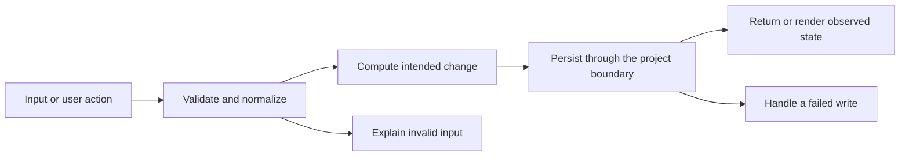

# Codebase map and reading order

[Course index](README.md)

## The problem this project solves

Number conversion and <= 0 did not reject all malformed values. Direct decimal accumulation complicated totals, and failed writes could put memory ahead of storage. The improvement you will study is: New amounts require positive bounded decimal text with at most two fractional digits and real dates. Totals accumulate cents. Create, edit and delete publish only after storage succeeds, retaining the form on failure.

## Data model

Stored amounts retain the original dollar-number format. New input is parsed into bounded cents, and totals accumulate rounded cents before dollar formatting.

An object is a named collection of fields. An array is an ordered collection of values. An id answers “which record?”; an index answers “where is it in this array right now?” Those questions are different whenever the list can be filtered, reordered or edited. Persisted data is the form that must survive a process/page restart. Derived data can be recomputed from that persisted state.

## Trace one action

1. Parse amount text to cents.
2. Validate required fields and date.
3. Construct the candidate array.
4. Write before publishing.
5. Derive totals in cents.
6. Format dollar display values.

This diagram names responsibilities, not necessarily separate files. A small browser program can keep them in app.js. A larger API spreads them across controllers, services and models. Follow the actual sequence above rather than assuming every repository has the same architecture.

## Where to read first

1. [app.js](../app.js): locate `parseCents` and read its inputs, branches and return/side effects.
2. [test/money.test.cjs](../test/money.test.cjs): read the scenario names before the helper code.
3. The root [README](../README.md): connect setup and the larger application workflow.

## Source navigation

- [app.js](../app.js)

## A practical reading technique

At each function boundary, write down the value coming in, the value going out and any side effect. A side effect includes a storage write, SQL query, network request, timer registration or DOM update. If a function calls another function, inspect only that next dependency until you can finish the chosen trace. Return to unrelated files later.

For this lesson, start with: **Income 0.10 plus 0.20 displays $0.30; 1.01 parses to 101 cents. Reject empty, zero, negative, 1.001, Infinity, scientific notation and values above 999999999.99. A failed edit to 12.50 keeps the prior amount and the entered form value.** Mark where the id, time, amount or other important value changes representation. For example, JSON serializes values into text; a date field may be a calendar string; SQL aggregates may return a different type from individual rows. Representation changes are common bug locations.

## Check your understanding

Without reading the solution, answer: Who owns the mutable state? Which input is untrusted? Which function first decides whether the operation is valid? What survives reload or restart? What observation would prove that the operation partially failed? Point to a source file for each answer, rather than describing a generic app from memory.
