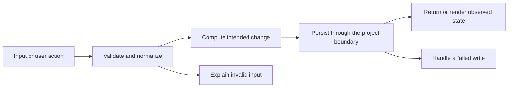

# Codebase map and reading order

[Course index](README.md)

## The problem this project solves

The form checked required fields but allowed two contacts with the same email. A naive uniqueness check would also reject an unchanged email while editing its owner. The improvement you will study is: Creates and edits reject case-insensitive, whitespace-normalized duplicates in another record. The message identifies the existing contact, marks the email invalid for assistive technology, focuses it, and leaves stored data unchanged.

## Data model

A contact has id, name, email, phone, company and relationship. Email comparison uses trim().toLowerCase(), but the displayed email retains the user’s spelling. The unique key for editing remains id, not email.

An object is a named collection of fields. An array is an ordered collection of values. An id answers “which record?”; an index answers “where is it in this array right now?” Those questions are different whenever the list can be filtered, reordered or edited. Persisted data is the form that must survive a process/page restart. Derived data can be recomputed from that persisted state.

## Trace one action

1. The form submits a contact payload.
2. saveContact trims required fields.
3. A normalized email is compared with other records.
4. The edited record is excluded by id.
5. A duplicate focuses the email field and stops before mutation.
6. A valid create/update is saved and rendered.

This diagram names responsibilities, not necessarily separate files. A small browser program can keep them in app.js. A larger API spreads them across controllers, services and models. Follow the actual sequence above rather than assuming every repository has the same architecture.

## Where to read first

1. [app.js](../app.js): locate `saveContact` and read its inputs, branches and return/side effects.
2. [test/duplicates.test.cjs](../test/duplicates.test.cjs): read the scenario names before the helper code.
3. The root [README](../README.md): connect setup and the larger application workflow.

## Source navigation

- [app.js](../app.js)

## A practical reading technique

At each function boundary, write down the value coming in, the value going out and any side effect. A side effect includes a storage write, SQL query, network request, timer registration or DOM update. If a function calls another function, inspect only that next dependency until you can finish the chosen trace. Return to unrelated files later.

For this lesson, start with: **Ada owns Ada@Example.com. Creating Other with " ada@example.COM " fails. Editing Ada’s phone while keeping Ada@Example.com succeeds. Changing Bob’s email to ADA@example.com fails.** Mark where the id, time, amount or other important value changes representation. For example, JSON serializes values into text; a date field may be a calendar string; SQL aggregates may return a different type from individual rows. Representation changes are common bug locations.

## Check your understanding

Without reading the solution, answer: Who owns the mutable state? Which input is untrusted? Which function first decides whether the operation is valid? What survives reload or restart? What observation would prove that the operation partially failed? Point to a source file for each answer, rather than describing a generic app from memory.
