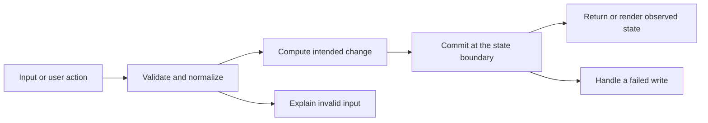

# Codebase map and reading order

[Course index](README.md)

## The problem this project solves

Status requests could add redundant history. Validation accepted malformed shapes, and page calculations lacked a consistent clamped result. The improvement you will study is: Typed and bounded inputs protect edits, real calendar dates round-trip, page numbers clamp and equal sort values use an id tie-breaker. Repeating the current status creates no extra status history. Actual changes update the in-memory record and append one status event. The shared toolbar now uses two flexible columns so its search field remains readable beside the form and activity panels.

## Data model

This app represents a maintenance work order and its responsible technician. A record uses generic fields id, title, owner, category, status, priority, amount, dueDate and notes. Categories are HVAC, Electrical, Network, Safety. Statuses are Open, Scheduled, In Progress, Completed. The UI gives these shared fields domain-specific labels. Maintenance due date is represented as a YYYY-MM-DD calendar string, not an instant. A repository array and its activity collection live only in the Node process. Restarting the server restores seeds; this change does not add durable storage.

An object is a named collection of fields. An array is an ordered collection of values. An id answers “which record?”; an index answers “where is it in this array right now?” Those questions are different whenever the list can be filtered, reordered or edited. Persisted data is the form that must survive a process/page restart. Derived data can be recomputed from that persisted state.

## Trace one action

1. The React event handler reads controlled form or filter state.
2. client/src/api.js serializes the request to the Express API.
3. server/server.js validates caller-controlled fields and normalizes accepted values.
4. The repository method reads or changes its in-memory records.
5. The route returns JSON or a bounded validation error.
6. React reloads or renders the response; server restart reconstructs seed state.

This diagram names responsibilities, not necessarily separate files. A small browser program can keep them in app.js. A larger API spreads them across controllers, services and models. Follow the actual sequence above rather than assuming every repository has the same architecture.

## Where to read first

1. [server/server.js](../server/server.js): locate `setStatus` and read its inputs, branches and return/side effects.
2. [test/workflow.test.js](../test/workflow.test.js): read the scenario names before the helper code.
3. The root [README](../README.md): connect setup and the larger application workflow.

## Source navigation

- [client/src/App.jsx](../client/src/App.jsx)
- [client/src/api.js](../client/src/api.js)
- [client/src/main.jsx](../client/src/main.jsx)
- [server/server.js](../server/server.js)
- [vite.config.js](../vite.config.js)

## A practical reading technique

At each function boundary, write down the value coming in, the value going out and any side effect. A side effect includes a storage write, SQL query, network request, timer registration or DOM update. If a function calls another function, inspect only that next dependency until you can finish the chosen trace. Return to unrelated files later.

For this lesson, start with: **Create a record titled "A lesson record" (the exact fixture in `test/workflow.test.*`; the seeded UI uses domain titles such as "Inspect west-wing ventilation") in category HVAC with status Open, amount 12.5 and dueDate 2028-02-29. Request Scheduled twice: one status event is added. An edit with dueDate 2027-02-29 returns 400 and preserves the old record. With three matching records and pageSize 2, page 999 clamps to page 2 with one item.** Mark where the id, time, amount or other important value changes representation. For example, JSON serializes values into text; a date field may be a calendar string; SQL aggregates may return a different type from individual rows. Representation changes are common bug locations.

## Check your understanding

Without reading the solution, answer: Who owns the mutable state? Which input is untrusted? Which function first decides whether the operation is valid? What survives reload or restart? What observation would prove that the operation partially failed? Point to a source file for each answer, rather than describing a generic app from memory.
