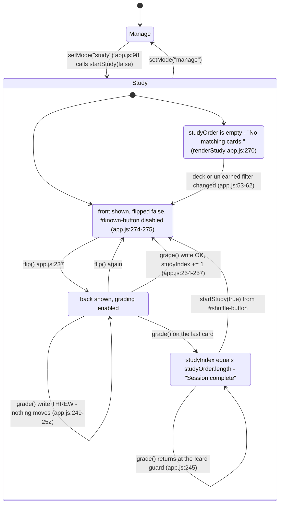

# Codebase map and reading order

[Course index](README.md)

## The problem this project solves

Grading the last card never advanced beyond it. Changing decks during study retained the old order, and there was no unlearned-only study option. The improvement you will study is: Study can select unlearned cards only, changing decks restarts the session, and the final grade produces an explicit completion state. Grading requires revealing the answer. Failed storage leaves the card and cursor unchanged.

## Data model

Cards have stable ids, deck, front, back and known. A session holds a snapshot of eligible ids, a cursor and a revealed-answer flag. Saved cards and temporary session state serve different purposes.

An object is a named collection of fields. An array is an ordered collection of values. An id answers “which record?”; an index answers “where is it in this array right now?” Those questions are different whenever the list can be filtered, reordered or edited. Persisted data is the form that must survive a process/page restart. Derived data can be recomputed from that persisted state.

## Trace one action

1. Choose deck and eligibility.
2. startStudy captures matching ids.
3. Reveal changes the current face.
4. grade constructs a candidate array.
5. Storage succeeds before publishing or advancing.
6. The renderer distinguishes empty, active and complete.

Three things to read off that diagram. `Revealed --> Revealed` is the change: a failed
`localStorage` write is a self-loop, not a transition, so no cell of the state moves. `Complete`
is a real state with `studyIndex === studyOrder.length`, not a cursor clamped to the last card -
that is why the old code could never leave the final card. And `Empty` and `Complete` both have
no current card but print different text, which is the branch on `total` at `app.js:269-273`.

## Where to read first

1. [app.js](../app.js): locate `grade` and read its inputs, branches and return/side effects.
2. [test/study.test.cjs](../test/study.test.cjs): read the scenario names before the helper code.
3. The root [README](../README.md): connect setup and the larger application workflow.

## Source navigation

- [app.js](../app.js)

## A practical reading technique

At each function boundary, write down the value coming in, the value going out and any side effect. A side effect includes a storage write, SQL query, network request, timer registration or DOM update. If a function calls another function, inspect only that next dependency until you can finish the chosen trace. Return to unrelated files later.

For this lesson, start with: **JS contains a unknown and b known; CSS contains c unknown. Select JS and unlearned-only: the session contains just a. Reveal and mark it known: progress becomes Completed 1 of 1 and grading is disabled. Restarting now finds no eligible cards. A rejected write instead keeps a at index zero.** Mark where the id, time, amount or other important value changes representation. For example, JSON serializes values into text; a date field may be a calendar string; SQL aggregates may return a different type from individual rows. Representation changes are common bug locations.

## Check your understanding

Without reading the solution, answer: Who owns the mutable state? Which input is untrusted? Which function first decides whether the operation is valid? What survives reload or restart? What observation would prove that the operation partially failed? Point to a source file for each answer, rather than describing a generic app from memory.
