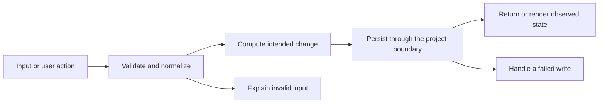

# Codebase map and reading order

[Course index](README.md)

## The problem this project solves

Each interval callback subtracted one second, so a throttled background tab could show a large amount of time remaining even after the session’s real duration had elapsed. The improvement you will study is: The interval is a wake-up mechanism. The deadline determines remaining time. Delayed callbacks catch up, pausing preserves fractions of a second, repeated starts do not stack intervals, and late callbacks cannot log the same completion twice.

## Data model

The timer has mode (idle/running/paused), remaining seconds, deadline milliseconds, duration seconds and intervalId. Session records are separate persisted history. A running timer is in-memory; page reload does not resume an active run.

An object is a named collection of fields. An array is an ordered collection of values. An id answers “which record?”; an index answers “where is it in this array right now?” Those questions are different whenever the list can be filtered, reordered or edited. Persisted data is the form that must survive a process/page restart. Derived data can be recomputed from that persisted state.

## Trace one action

1. Start records a deadline and schedules one interval.
2. Each callback reads deadline minus Date.now().
3. The UI rounds remaining seconds upward for display.
4. Pause captures the exact fractional remainder.
5. Resume builds a new deadline from that remainder.
6. Completion clears scheduling and moves out of running before logging.

This diagram names responsibilities, not necessarily separate files. A small browser program can keep them in app.js. A larger API spreads them across controllers, services and models. Follow the actual sequence above rather than assuming every repository has the same architecture.

## Where to read first

1. [app.js](../app.js): locate `tick` and read its inputs, branches and return/side effects.
2. [test/timer.test.cjs](../test/timer.test.cjs): read the scenario names before the helper code.
3. The root [README](../README.md): connect setup and the larger application workflow.

## Source navigation

- [app.js](../app.js)

## A practical reading technique

At each function boundary, write down the value coming in, the value going out and any side effect. A side effect includes a storage write, SQL query, network request, timer registration or DOM update. If a function calls another function, inspect only that next dependency until you can finish the chosen trace. Return to unrelated files later.

For this lesson, start with: **A 60-second session starts at t=0. The browser delays callbacks until t=45: one tick must display 00:15, not 00:59. At t=75 the next tick completes once. If paused at 1.25 seconds, 58.75 seconds remain; a two-minute pause does not consume them.** Mark where the id, time, amount or other important value changes representation. For example, JSON serializes values into text; a date field may be a calendar string; SQL aggregates may return a different type from individual rows. Representation changes are common bug locations.

## Check your understanding

Without reading the solution, answer: Who owns the mutable state? Which input is untrusted? Which function first decides whether the operation is valid? What survives reload or restart? What observation would prove that the operation partially failed? Point to a source file for each answer, rather than describing a generic app from memory.
