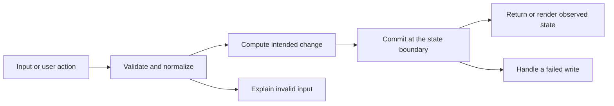

# Codebase map and reading order

[Course index](README.md)

## The problem this project solves

Counting and fetching rows in separate snapshots could disagree, and an out-of-range page could strand the user on an empty result after deletion. The improvement you will study is: Search count and rows share a read-only repeatable-read transaction. Page numbers clamp to the available range, ordering has an id tie-breaker, and thread/tag inputs and author references are validated.

## Data model

Threads belong to authors and can carry tags. A filtered result consists of items, total, page and page count; these values describe one database snapshot for that request. They are not independent facts to calculate with unrelated filters.

An object is a named collection of fields. An array is an ordered collection of values. An id answers “which record?”; an index answers “where is it in this array right now?” Those questions are different whenever the list can be filtered, reordered or edited. Persisted data is the form that must survive a process/page restart. Derived data can be recomputed from that persisted state.

## Trace one action

1. The React handler collects form or filter state.
2. client/src/api.ts sends typed client data as untyped JSON over HTTP.
3. server/src/index.ts validates runtime values at the server boundary.
4. server/src/db.ts supplies a pool or one transaction client for the relevant SQL.
5. PostgreSQL constraints and the transaction boundary protect the stored relationships described in this lesson.
6. The API maps rows to its JSON representation and React renders the observed result.

This diagram names responsibilities, not necessarily separate files. A small browser program can keep them in app.js. A larger API spreads them across controllers, services and models. Follow the actual sequence above rather than assuming every repository has the same architecture.

## Where to read first

1. [server/src/index.ts](../server/src/index.ts): locate `REPEATABLE READ` and read its inputs, branches and return/side effects.
2. [test/feature.test.ts](../test/feature.test.ts): read the scenario names before the helper code.
3. The root [README](../README.md): connect setup and the larger application workflow.

## Source navigation

- [client/src/App.tsx](../client/src/App.tsx)
- [client/src/api.ts](../client/src/api.ts)
- [client/src/main.tsx](../client/src/main.tsx)
- [client/src/vite-env.d.ts](../client/src/vite-env.d.ts)
- [server/src/db.ts](../server/src/db.ts)
- [server/src/index.ts](../server/src/index.ts)
- [shared/types.ts](../shared/types.ts)
- [vite.config.ts](../vite.config.ts)

## A practical reading technique

At each function boundary, write down the value coming in, the value going out and any side effect. A side effect includes a storage write, SQL query, network request, timer registration or DOM update. If a function calls another function, inspect only that next dependency until you can finish the chosen trace. Return to unrelated files later.

For this lesson, start with: **Create three threads that match a unique search term and a shared tag, request the list with pageSize 2, and repeat the request: both responses report total 3 and the same ids in the same order. Request page 999 of that query: the response clamps to page 2 with one item and total 3. A search with no matches clamps to page 1 with total 0. Malformed tag or author data is rejected with 400 and the thread count is unchanged.** Mark where the id, time, amount or other important value changes representation. For example, JSON serializes values into text; a date field may be a calendar string; SQL aggregates may return a different type from individual rows. Representation changes are common bug locations.

## Check your understanding

Without reading the solution, answer: Who owns the mutable state? Which input is untrusted? Which function first decides whether the operation is valid? What survives reload or restart? What observation would prove that the operation partially failed? Point to a source file for each answer, rather than describing a generic app from memory.
