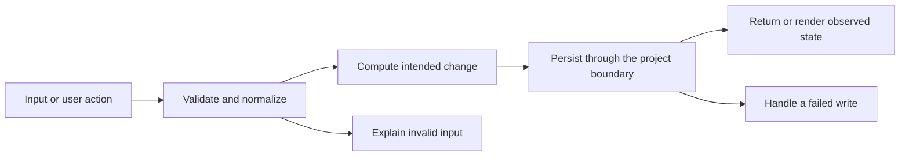

# Codebase map and reading order

[Course index](README.md)

## The problem this project solves

The current streak required today to be checked already, and there was no longest historical streak. The improvement you will study is: A current streak may continue through yesterday while today is still in progress. The best badge counts consecutive real dates, ignoring invalid, false and future entries. Day buttons have full accessible names.

## Data model

Each habit has a history map from YYYY-MM-DD to true. Current and best streaks are derived values, not independently persisted counters.

An object is a named collection of fields. An array is an ordered collection of values. An id answers “which record?”; an index answers “where is it in this array right now?” Those questions are different whenever the list can be filtered, reordered or edited. Persisted data is the form that must survive a process/page restart. Derived data can be recomputed from that persisted state.

## Trace one action

1. Read history without mutation.
2. Validate real checked dates.
3. Exclude future dates.
4. Sort day ordinals and scan runs.
5. Calculate current from today or yesterday.
6. Render both badges from history.

This diagram names responsibilities, not necessarily separate files. A small browser program can keep them in app.js. A larger API spreads them across controllers, services and models. Follow the actual sequence above rather than assuming every repository has the same architecture.

## Where to read first

1. [app.js](../app.js): locate `bestStreak` and read its inputs, branches and return/side effects.
2. [test/streaks.test.cjs](../test/streaks.test.cjs): read the scenario names before the helper code.
3. The root [README](../README.md): connect setup and the larger application workflow.

## Source navigation

- [app.js](../app.js)

## A practical reading technique

At each function boundary, write down the value coming in, the value going out and any side effect. A side effect includes a storage write, SQL query, network request, timer registration or DOM update. If a function calls another function, inspect only that next dependency until you can finish the chosen trace. Return to unrelated files later.

For this lesson, start with: **Checks on February 28, February 29 and March 1, 2024 give best three. Add March 3 and invalid February 30: best remains three. With today March 11, checks on March 9 and 10 give current two; a check only on March 9 gives zero.** Mark where the id, time, amount or other important value changes representation. For example, JSON serializes values into text; a date field may be a calendar string; SQL aggregates may return a different type from individual rows. Representation changes are common bug locations.

## Check your understanding

Without reading the solution, answer: Who owns the mutable state? Which input is untrusted? Which function first decides whether the operation is valid? What survives reload or restart? What observation would prove that the operation partially failed? Point to a source file for each answer, rather than describing a generic app from memory.
