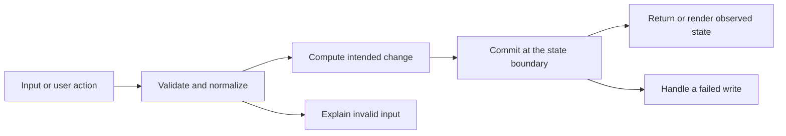

# Codebase map and reading order

[Course index](README.md)

## The problem this project solves

Dragging changed a live card before saving, renumbered only the destination, and made self-drops surprising. Movement required drag events. The improvement you will study is: Moves validate targets, ignore self-drops, calculate a candidate and renumber every column before saving. Failed moves preserve state. Column selects and move-up/down buttons support keyboard use and restore focus.

## Data model

Each card has id, title, column and order. Column is todo/doing/done; order is a zero-based position within that column. The browser stores the card array under js1-kanban-flow.

An object is a named collection of fields. An array is an ordered collection of values. An id answers “which record?”; an index answers “where is it in this array right now?” Those questions are different whenever the list can be filtered, reordered or edited. Persisted data is the form that must survive a process/page restart. Derived data can be recomputed from that persisted state.

## Trace one action

1. The browser loads index.html and app.js.
2. An event handler reads the selected record and current form controls.
3. Validation checks the intended operation before calculating candidate state.
4. The shared save/move boundary attempts the localStorage write.
5. A successful write publishes the candidate and rerenders; a rejected write keeps the promised previous state.
6. A fresh read after reload reveals the saved result.

This diagram names responsibilities, not necessarily separate files. A small browser program can keep them in app.js. A larger API spreads them across controllers, services and models. Follow the actual sequence above rather than assuming every repository has the same architecture.

## Where to read first

1. [app.js](../app.js): locate `moveCard` and read its inputs, branches and return/side effects.
2. [test/movement.test.cjs](../test/movement.test.cjs): read the scenario names before the helper code.
3. The root [README](../README.md): connect setup and the larger application workflow.

## Source navigation

- [app.js](../app.js)

## A practical reading technique

At each function boundary, write down the value coming in, the value going out and any side effect. A side effect includes a storage write, SQL query, network request, timer registration or DOM update. If a function calls another function, inspect only that next dependency until you can finish the chosen trace. Return to unrelated files later.

For this lesson, start with: **Move A from todo [A,B] before C in doing. B becomes order 0; A/C become orders 0/1. A self-drop does nothing. Reject setItem and the previous card array remains identical.** Mark where the id, time, amount or other important value changes representation. For example, JSON serializes values into text; a date field may be a calendar string; SQL aggregates may return a different type from individual rows. Representation changes are common bug locations.

## Check your understanding

Without reading the solution, answer: Who owns the mutable state? Which input is untrusted? Which function first decides whether the operation is valid? What survives reload or restart? What observation would prove that the operation partially failed? Point to a source file for each answer, rather than describing a generic app from memory.
