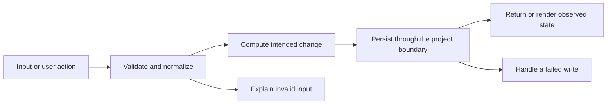

# Codebase map and reading order

[Course index](README.md)

## The problem this project solves

Concurrent operations could read the same file version and overwrite each other. Direct target writes risked truncation. The client imported a component without mounting React. The improvement you will study is: Operations serialize through one queue. Writes use a unique sibling file and rename after writing succeeds. Failure preserves old bytes and does not poison later operations. HTTP errors are handled and Vite mounts the client correctly.

## Data model

A JSON file owns the note array. One repository instance owns a promise tail ordering every read-modify-write. Identity survives edits and restarts.

An object is a named collection of fields. An array is an ordered collection of values. An id answers “which record?”; an index answers “where is it in this array right now?” Those questions are different whenever the list can be filtered, reordered or edited. Persisted data is the form that must survive a process/page restart. Derived data can be recomputed from that persisted state.

## Trace one action

1. Validate the HTTP input.
2. Join the repository queue.
3. Read the latest complete file.
4. Build a candidate array.
5. Write a sibling file and rename.
6. Return success or a handled error while keeping the queue usable.

This diagram names responsibilities, not necessarily separate files. A small browser program can keep them in app.js. A larger API spreads them across controllers, services and models. Follow the actual sequence above rather than assuming every repository has the same architecture.

## Where to read first

1. [server/repository.js](../server/repository.js): locate `createNoteRepository` and read its inputs, branches and return/side effects.
2. [test/persistence.test.js](../test/persistence.test.js): read the scenario names before the helper code.
3. The root [README](../README.md): connect setup and the larger application workflow.

## Source navigation

- [client/src/App.jsx](../client/src/App.jsx)
- [client/src/api.js](../client/src/api.js)
- [client/src/main.jsx](../client/src/main.jsx)
- [server/repository.js](../server/repository.js)
- [server/server.js](../server/server.js)
- [vite.config.js](../vite.config.js)

## A practical reading technique

At each function boundary, write down the value coming in, the value going out and any side effect. A side effect includes a storage write, SQL query, network request, timer registration or DOM update. If a function calls another function, inspect only that next dependency until you can finish the chosen trace. Return to unrelated files later.

For this lesson, start with: **With one welcome note, twelve concurrent creates leave thirteen records. Pin four created ids: those four are pinned independently of the welcome note. Reject a rename, compare original bytes, retry successfully and reopen the repository to read the result.** Mark where the id, time, amount or other important value changes representation. For example, JSON serializes values into text; a date field may be a calendar string; SQL aggregates may return a different type from individual rows. Representation changes are common bug locations.

## Check your understanding

Without reading the solution, answer: Who owns the mutable state? Which input is untrusted? Which function first decides whether the operation is valid? What survives reload or restart? What observation would prove that the operation partially failed? Point to a source file for each answer, rather than describing a generic app from memory.
