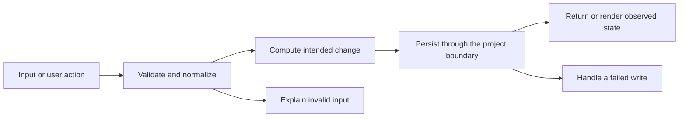

# Codebase map and reading order

[Course index](README.md)

## The problem this project solves

Fresh really meant above the stock threshold, so an expired item could appear fresh. Some invalid numeric values passed validation. The improvement you will study is: Rows show stock and expiration independently. Expired filtering is available, and the in-stock/nonexpired view excludes expired items. New quantities must be finite and nonnegative, dates must be real, and returning to the tab refreshes date-based status.

## Data model

Quantity, minimum and expiration are separate fields. Low means quantity <= minimum. Expired means the YYYY-MM-DD label is earlier than local today.

An object is a named collection of fields. An array is an ordered collection of values. An id answers “which record?”; an index answers “where is it in this array right now?” Those questions are different whenever the list can be filtered, reordered or edited. Persisted data is the form that must survive a process/page restart. Derived data can be recomputed from that persisted state.

## Trace one action

1. Read local today.
2. Evaluate low and expired separately.
3. Compose status and search predicates.
4. Render both conditions.
5. Validate new numbers and dates.
6. Refresh derived status when the tab returns.

This diagram names responsibilities, not necessarily separate files. A small browser program can keep them in app.js. A larger API spreads them across controllers, services and models. Follow the actual sequence above rather than assuming every repository has the same architecture.

## Where to read first

1. [app.js](../app.js): locate `getVisibleItems` and read its inputs, branches and return/side effects.
2. [test/expiration.test.cjs](../test/expiration.test.cjs): read the scenario names before the helper code.
3. The root [README](../README.md): connect setup and the larger application workflow.

## Source navigation

- [app.js](../app.js)

## A practical reading technique

At each function boundary, write down the value coming in, the value going out and any side effect. A side effect includes a storage write, SQL query, network request, timer registration or DOM update. If a function calls another function, inspect only that next dependency until you can finish the chosen trace. Return to unrelated files later.

For this lesson, start with: **On September 8, an item expiring September 7 with quantity five and minimum one is Stock OK and Expired. An item expiring today with quantity one and minimum one is Low stock and not expired. Only a future sufficiently stocked item matches the combined view.** Mark where the id, time, amount or other important value changes representation. For example, JSON serializes values into text; a date field may be a calendar string; SQL aggregates may return a different type from individual rows. Representation changes are common bug locations.

## Check your understanding

Without reading the solution, answer: Who owns the mutable state? Which input is untrusted? Which function first decides whether the operation is valid? What survives reload or restart? What observation would prove that the operation partially failed? Point to a source file for each answer, rather than describing a generic app from memory.
