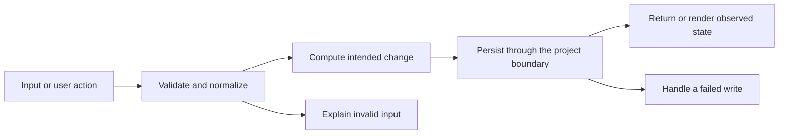

# Codebase map and reading order

[Course index](README.md)

## The problem this project solves

Search and sorting existed without an explicit status filter or matching-versus-overall summary. Equal ratings relied on source order. The improvement you will study is: Status filtering composes with search and sorting. Rating ties use title then id. The live summary distinguishes visible books from overall finished count, and sorting preserves saved order.

## Data model

Saved books contain id, title, author, status, rating and notes. Search, status filter and sorting are temporary view state.

An object is a named collection of fields. An array is an ordered collection of values. An id answers “which record?”; an index answers “where is it in this array right now?” Those questions are different whenever the list can be filtered, reordered or edited. Persisted data is the form that must survive a process/page restart. Derived data can be recomputed from that persisted state.

## Trace one action

1. Read search, status and sort.
2. Copy and filter the book collection.
3. Sort the projection.
4. Render matching cards.
5. Compute visible and overall counts separately.
6. Show the empty state when appropriate.

This diagram names responsibilities, not necessarily separate files. A small browser program can keep them in app.js. A larger API spreads them across controllers, services and models. Follow the actual sequence above rather than assuming every repository has the same architecture.

## Where to read first

1. [app.js](../app.js): locate `getVisibleBooks` and read its inputs, branches and return/side effects.
2. [test/filters.test.cjs](../test/filters.test.cjs): read the scenario names before the helper code.
3. The root [README](../README.md): connect setup and the larger application workflow.

## Source navigation

- [app.js](../app.js)

## A practical reading technique

At each function boundary, write down the value coming in, the value going out and any side effect. A side effect includes a storage write, SQL query, network request, timer registration or DOM update. If a function calls another function, inspect only that next dependency until you can finish the chosen trace. Return to unrelated files later.

For this lesson, start with: **Zebra and Alpha both have rating five and Finished status; Beta is Reading. Filter Finished, search Maya and sort by rating: Alpha then Zebra appear. Saved order remains Zebra, Alpha, Beta. An unmatched query shows zero results while overall finished stays two.** Mark where the id, time, amount or other important value changes representation. For example, JSON serializes values into text; a date field may be a calendar string; SQL aggregates may return a different type from individual rows. Representation changes are common bug locations.

## Check your understanding

Without reading the solution, answer: Who owns the mutable state? Which input is untrusted? Which function first decides whether the operation is valid? What survives reload or restart? What observation would prove that the operation partially failed? Point to a source file for each answer, rather than describing a generic app from memory.
