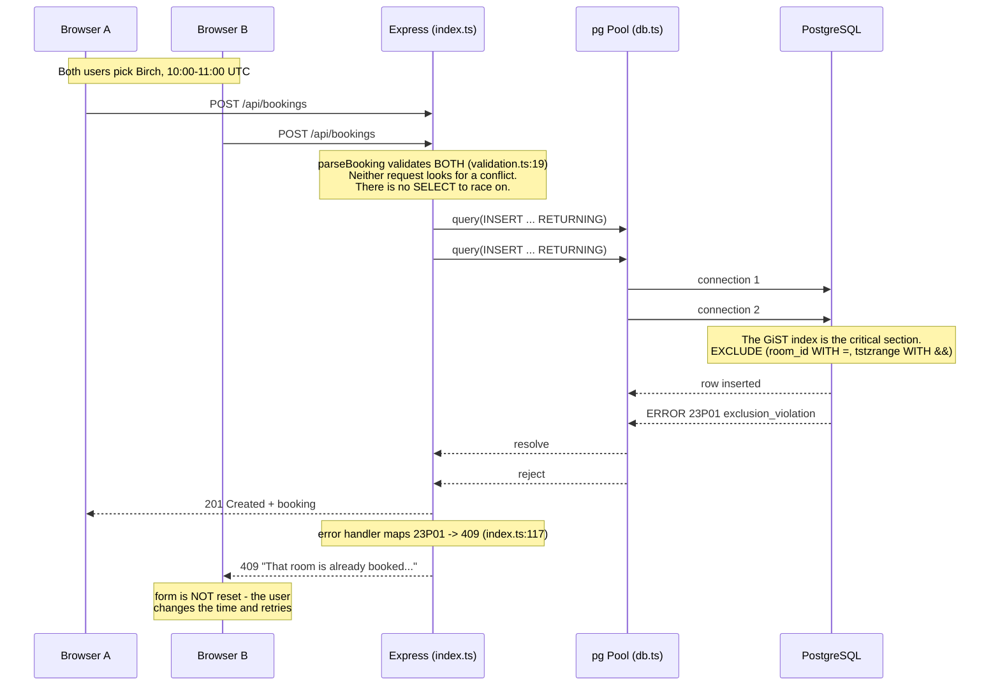

# Codebase map and reading order

[Course index](README.md)

## The problem this project solves

The UI could not edit although PUT existed. Runtime checks accepted malformed types or ambiguous timestamps, and local slot defaults mishandled midnight rollover. The improvement you will study is: The UI edits existing ids and converts local input to explicit instants. The API validates ids, bounded text, real timestamps and forward windows. Day views send browser-local boundaries; a legacy date query explicitly means a UTC day. Database overlap enforcement is verified under concurrency and failed edits.

## Data model

Bookings link a room UUID to a title, bookedBy label and two instants. PostgreSQL stores timestamptz and enforces room-specific nonoverlap using a GiST exclusion constraint.

An object is a named collection of fields. An array is an ordered collection of values. An id answers “which record?”; an index answers “where is it in this array right now?” Those questions are different whenever the list can be filtered, reordered or edited. Persisted data is the form that must survive a process/page restart. Derived data can be recomputed from that persisted state.

## Trace one action

1. Load an existing booking into the editor.
2. Convert local inputs to ISO instants.
3. Validate UUIDs, text and time range.
4. Let the database arbitrate overlap.
5. Retain the editor on conflict.
6. Refresh the schedule after an identity-preserving update.

The picture that matters for this project is not a box diagram of the layers - it is **two
requests racing**, because the whole lesson is which component resolves the race.

Three things to read off it, and they are the three things the course is for:

1. **There is no application check.** Look for a `SELECT ... WHERE overlaps` in
   `server/src/index.ts`; there isn't one, on purpose. Two requests can both observe "no conflict"
   before either inserts, and no amount of application code closes that window.
2. **The arbiter is the index, not the code.** The constraint is checked as part of taking the
   index entry, so there is no gap between deciding and writing. That is what makes a *test* of it
   meaningful rather than hopeful.
3. **The application's whole job is translation.** SQLSTATE `23P01` becomes HTTP 409 becomes a
   sentence, and the form survives so the user can act on it.

The layered view still exists - `client/src/api.ts` → `index.ts` route → `validation.ts` →
`db.ts` pool → SQL - and `07-TRACE-LAB.md` walks all six boundaries in order. But if you remember
one diagram from this project, remember this one.

## Where to read first

1. [server/src/validation.ts](../server/src/validation.ts): locate `parseBooking` and read its inputs, branches and return/side effects.
2. [test/booking.test.ts](../test/booking.test.ts): read the scenario names before the helper code.
3. The root [README](../README.md): connect setup and the larger application workflow.

## Source navigation

- [client/src/App.tsx](../client/src/App.tsx)
- [client/src/api.ts](../client/src/api.ts)
- [client/src/main.tsx](../client/src/main.tsx)
- [client/src/vite-env.d.ts](../client/src/vite-env.d.ts)
- [server/src/db.ts](../server/src/db.ts)
- [server/src/index.ts](../server/src/index.ts)
- [server/src/validation.ts](../server/src/validation.ts)
- [shared/types.ts](../shared/types.ts)
- [vite.config.ts](../vite.config.ts)

## A practical reading technique

At each function boundary, write down the value coming in, the value going out and any side effect. A side effect includes a storage write, SQL query, network request, timer registration or DOM update. If a function calls another function, inspect only that next dependency until you can finish the chosen trace. Return to unrelated files later.

For this lesson, start with: **Two requests for one room from 10:00 to 11:00 UTC yield one 201 and one 409. An adjacent 11:00-to-12:00 slot succeeds. Extending the first to 11:30 fails and preserves its old end. Renaming preserves its id. A query window ending at 11:00 excludes the adjacent slot.** Mark where the id, time, amount or other important value changes representation. For example, JSON serializes values into text; a date field may be a calendar string; SQL aggregates may return a different type from individual rows. Representation changes are common bug locations.

## Check your understanding

Without reading the solution, answer: Who owns the mutable state? Which input is untrusted? Which function first decides whether the operation is valid? What survives reload or restart? What observation would prove that the operation partially failed? Point to a source file for each answer, rather than describing a generic app from memory.
