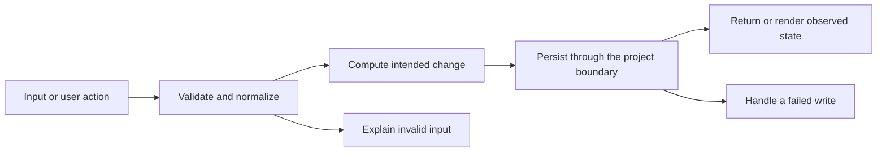

# Codebase map and reading order

[Course index](README.md)

## The problem this project solves

The store mutated before writing, duplicate tag variants accumulated, and rejected clipboard promises could escape without feedback. The improvement you will study is: Create, edit and delete publish only after persistence succeeds. Tags deduplicate case-insensitively, missing edit ids and blank content are rejected, and clipboard denial returns false so the UI can explain failure.

## Data model

The store owns snippets, main.js owns forms and views, and dom.js owns rendering/clipboard work. Tags retain their first display spelling while deduplicating lowercase comparison keys.

An object is a named collection of fields. An array is an ordered collection of values. An id answers “which record?”; an index answers “where is it in this array right now?” Those questions are different whenever the list can be filtered, reordered or edited. Persisted data is the form that must survive a process/page restart. Derived data can be recomputed from that persisted state.

## Trace one action

1. Collect form values.
2. Normalize candidate fields and tags.
3. Reject blank content or missing edit ids.
4. Commit before publishing.
5. Retain the form after rejection.
6. Handle clipboard permission failure.

This diagram names responsibilities, not necessarily separate files. A small browser program can keep them in app.js. A larger API spreads them across controllers, services and models. Follow the actual sequence above rather than assuming every repository has the same architecture.

## Where to read first

1. [src/store.js](../src/store.js): locate `saveSnippet` and read its inputs, branches and return/side effects.
2. [test/store.test.js](../test/store.test.js): read the scenario names before the helper code.
3. The root [README](../README.md): connect setup and the larger application workflow.

## Source navigation

- [src/dom.js](../src/dom.js)
- [src/main.js](../src/main.js)
- [src/store.js](../src/store.js)

## A practical reading technique

At each function boundary, write down the value coming in, the value going out and any side effect. A side effect includes a storage write, SQL query, network request, timer registration or DOM update. If a function calls another function, inspect only that next dependency until you can finish the chosen trace. Return to unrelated files later.

For this lesson, start with: **Tags Utility,utility, EVENTS,events become Utility and EVENTS. A failed title-edit write leaves saved and in-memory titles unchanged. Clipboard rejection resolves false instead of producing an unhandled rejection.** Mark where the id, time, amount or other important value changes representation. For example, JSON serializes values into text; a date field may be a calendar string; SQL aggregates may return a different type from individual rows. Representation changes are common bug locations.

## Check your understanding

Without reading the solution, answer: Who owns the mutable state? Which input is untrusted? Which function first decides whether the operation is valid? What survives reload or restart? What observation would prove that the operation partially failed? Point to a source file for each answer, rather than describing a generic app from memory.
