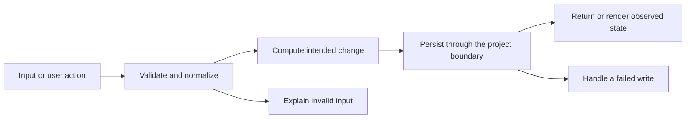

# Codebase map and reading order

[Course index](README.md)

## The problem this project solves

Deletion previously filtered the task out and saved the smaller array. The information needed to reverse deletion was lost. The improvement you will study is: One localStorage value now holds both the visible tasks and the most recent deleted task. Delete and undo persist before publishing their new in-memory state. Undo clears old filters so the restored task is visible.

## Data model

The v2 document is {version: 2, tasks: [...], deleted: {task, index} | null}. A legacy array becomes a document with deleted: null. The task id is stable across delete and restore; its array position is not its identity.

An object is a named collection of fields. An array is an ordered collection of values. An id answers “which record?”; an index answers “where is it in this array right now?” Those questions are different whenever the list can be filtered, reordered or edited. Persisted data is the form that must survive a process/page restart. Derived data can be recomputed from that persisted state.

## Trace one action

1. Delete button passes the task id.
2. deleteTask finds the record and its original index.
3. commitBoard writes tasks and the deleted record together.
4. render updates the cards and undo availability.
5. loadBoard restores the saved recovery record after reload.
6. undoDelete reinserts the same identity and consumes recovery once.

This diagram names responsibilities, not necessarily separate files. A small browser program can keep them in app.js. A larger API spreads them across controllers, services and models. Follow the actual sequence above rather than assuming every repository has the same architecture.

## Where to read first

1. [app.js](../app.js): locate `commitBoard` and read its inputs, branches and return/side effects.
2. [test/undo.test.cjs](../test/undo.test.cjs): read the scenario names before the helper code.
3. The root [README](../README.md): connect setup and the larger application workflow.

## Source navigation

- [app.js](../app.js)

## A practical reading technique

At each function boundary, write down the value coming in, the value going out and any side effect. A side effect includes a storage write, SQL query, network request, timer registration or DOM update. If a function calls another function, inspect only that next dependency until you can finish the chosen trace. Return to unrelated files later.

For this lesson, start with: **Start with task ids [a, b, c]. Delete b: visible ids become [a, c] and recovery stores b at index 1. Reload. Undo: ids become [a, b, c], and recovery becomes null. A second undo changes nothing.** Mark where the id, time, amount or other important value changes representation. For example, JSON serializes values into text; a date field may be a calendar string; SQL aggregates may return a different type from individual rows. Representation changes are common bug locations.

## Check your understanding

Without reading the solution, answer: Who owns the mutable state? Which input is untrusted? Which function first decides whether the operation is valid? What survives reload or restart? What observation would prove that the operation partially failed? Point to a source file for each answer, rather than describing a generic app from memory.
