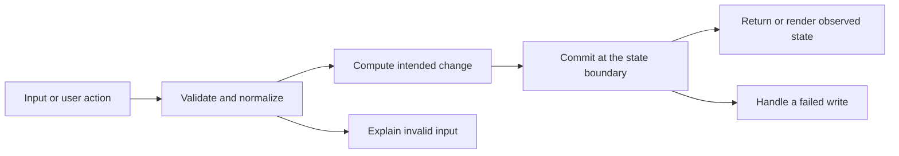

# Codebase map and reading order

[Course index](README.md)

## The problem this project solves

Status requests could add redundant history. Validation accepted malformed shapes, and page calculations lacked a consistent clamped result. Separate status and history writes could disagree after a late failure; separate count/page queries could see different snapshots. Seed dueDate values also needed correct JSON-to-SQL field mapping. The improvement you will study is: Typed and bounded inputs protect edits, real calendar dates round-trip, page numbers clamp and equal sort values use an id tie-breaker. Repeating the current status creates no extra status history. Status and audit writes use one row-locked transaction; count and rows share a repeatable-read snapshot. Seed dates map to the intended column. The shared toolbar now uses two flexible columns so its search field remains readable beside the form and activity panels.

## Data model

This app represents a travel request and its requester. A record uses generic fields id, title, owner, category, status, priority, amount, dueDate and notes. Categories are Conference, Customer Visit, Training, Internal Offsite. Statuses are Draft, Submitted, Approved, Booked, Rejected. The UI gives these shared fields domain-specific labels. Travel decision deadline is represented as a YYYY-MM-DD calendar string, not an instant. PostgreSQL items and activity_entries tables persist records and their child history.

An object is a named collection of fields. An array is an ordered collection of values. An id answers “which record?”; an index answers “where is it in this array right now?” Those questions are different whenever the list can be filtered, reordered or edited. Persisted data is the form that must survive a process/page restart. Derived data can be recomputed from that persisted state.

## Trace one action

1. The React handler collects form or filter state.
2. client/src/api.ts sends typed client data as untyped JSON over HTTP.
3. server/src/index.ts validates runtime values at the server boundary.
4. server/src/db.ts supplies a pool or one transaction client for the relevant SQL.
5. PostgreSQL constraints and the transaction boundary protect the stored relationships described in this lesson.
6. The API maps rows to its JSON representation and React renders the observed result.

This diagram names responsibilities, not necessarily separate files. A small browser program can keep them in app.js. A larger API spreads them across controllers, services and models. Follow the actual sequence above rather than assuming every repository has the same architecture.

## Where to read first

1. [server/src/index.ts](../server/src/index.ts): locate `app.patch("/api/travel/:id/status"` and read its inputs, branches and return/side effects.
2. [test/workflow.test.ts](../test/workflow.test.ts): read the scenario names before the helper code.
3. The root [README](../README.md): connect setup and the larger application workflow.

## Source navigation

- [client/src/App.tsx](../client/src/App.tsx)
- [client/src/api.ts](../client/src/api.ts)
- [client/src/main.tsx](../client/src/main.tsx)
- [client/src/vite-env.d.ts](../client/src/vite-env.d.ts)
- [server/src/db.ts](../server/src/db.ts)
- [server/src/index.ts](../server/src/index.ts)
- [shared/types.ts](../shared/types.ts)
- [vite.config.ts](../vite.config.ts)

## A practical reading technique

At each function boundary, write down the value coming in, the value going out and any side effect. A side effect includes a storage write, SQL query, network request, timer registration or DOM update. If a function calls another function, inspect only that next dependency until you can finish the chosen trace. Return to unrelated files later.

For this lesson, start with: **Create "Training visit to the regional office" in Conference with status Draft, amount 12.50 and dueDate 2028-02-29. Request Submitted twice: one status event is added. An edit with dueDate 2027-02-29 returns 400 and preserves the old record. With three matching records and pageSize 2, page 999 clamps to page 2 with one item. A forced activity-insert failure leaves both the record and its prior history unchanged.** Mark where the id, time, amount or other important value changes representation. For example, JSON serializes values into text; a date field may be a calendar string; SQL aggregates may return a different type from individual rows. Representation changes are common bug locations.

## Check your understanding

Without reading the solution, answer: Who owns the mutable state? Which input is untrusted? Which function first decides whether the operation is valid? What survives reload or restart? What observation would prove that the operation partially failed? Point to a source file for each answer, rather than describing a generic app from memory.
